<div align="center">

# 🏭 Industrial Defect Detection

**End-to-end defect detection on the MVTec AD dataset, combining a Deep Learning module (PyTorch / YOLO) with a complete MLOps stack.**

<br>


<br>

[📋 Overview](#-overview) •
[🏗 Architecture](#-architecture) •
[✨ Features](#-features) •
[📦 Getting Started](#-getting-started) •
[🚀 Usage](#-usage) •
[🧠 Deep Learning](#-deep-learning-pipeline) •
[⚙️ MLOps](#️-mlops-pipeline) •
[⚠️ Limitations](#️-known-limitations)

</div>

---

> [!NOTE]
> **Status: Completed.** The system is fully functional end to end, featuring a two-stage architecture (multi-class classification + detection), a containerized API, a modern web interface, and a complete CI/CD/CT MLOps pipeline. The Continuous Training workflow is triggered by the API feedback dispatch, a push on `data/feedback/`, a daily cron (03:00 UTC) or manually.

## 📋 Overview

The project covers two complementary areas:

| Area | Scope |
|:-----|:------|
| 🧠 **Deep Learning** | Multi-class classification (ResNet18: `good`, `broken_large`, `broken_small`, `contamination`) and detection (YOLOv8n) on the **bottle** category of MVTec AD, with progressive fine-tuning, class-weighted loss and bounding-box localization. |
| ⚙️ **MLOps** | Data versioning (DVC), experiment tracking (MLflow), inference API (FastAPI), containerization (Docker), CI/CD/CT (GitHub Actions + kind), a local Kubernetes deployment (Minikube, 2 replicas), drift monitoring (Evidently), alerting, and a feedback loop for active learning. |

## 🏗 Architecture

<div align="center">



</div>

| Stage | Description |
|:------|:------------|
| 📊 **1. Data & Training** | The dataset is versioned with DVC. Training pipelines produce models serialized to ONNX, and MLflow tracks every classifier experiment. |
| 🌐 **2. Serving** | The FastAPI service loads the ONNX models and exposes `/predict` (classifier + YOLO), `/feedback`, `/health` and `/config`. The React frontend supports image upload, webcam capture, and bounding-box visualization. |
| 🔄 **3. MLOps** | User-reported errors are stored in `data/feedback/`, uploaded to GitHub with retries, and trigger Continuous Training (CT) through GitHub Actions. CI, CD and monitoring run on GitHub; Docker orchestrates the local stack. |

**Division of labour.** The classifier *decides* (good or defective, and which defect type); the detector *illustrates* (boxes around the zones that support the verdict). A `good` verdict returns no box.

## ✨ Features

- 🤖 **Dual-model inference**: ResNet18 defect-type classifier (`good`, `broken_large`, `broken_small`, `contamination`) followed by YOLOv8n (defect localization).
- 🏷 **Defect-type badge**: the API returns `label`, `defect_type`, `confidence`, per-class probabilities, the class list and the boxes; the frontend displays a localized badge (FR/EN) and one probability bar per class.
- 🛑 **Uncertainty guard**: a defective prediction with confidence below 0.5 is refused with HTTP 422 (`uncertain category`) instead of being shown as a fact.
- 🎨 **Modern React interface**: Tailwind-based design, i18n (FR/EN), camera input, feedback dropdown by defect type, and bounding-box overlay drawn on a canvas.
- 🔁 **Feedback loop**: a "Report an error" flow saves the image and corrected label to `data/feedback/`, uploads the pair to GitHub with retries, and dispatches CT.
- 🗂 **Full versioning**: Git (code + ONNX serving artefacts), DVC (data), MLflow (experiments).
- ✅ **34 automated tests**: API contract, multi-class data checks, model factory, GitHub sync, and non-regression metrics.
- 🛠 **GitHub Actions CI**: installs `libgl1`, runs the test suite and the alert gate.
- 🚀 **CD**: builds the API image, deploys 2 replicas to kind, runs `/health` + `/predict` smoke tests, then pushes to GHCR on `main`.

## 📦 Getting Started

### Prerequisites

| Requirement | Version |
|:------------|:--------|
| 🐍 Python | 3.11 |
| 🟢 Node.js | 22+ |
| 🐳 Docker Desktop | Latest |
| ☸️ Minikube | Latest |

### 1. Backend & API

```bash
py -3.11 -m venv .venv
.\.venv\Scripts\Activate.ps1  # Windows
pip install -r requirements.txt
```

### 2. Data

```bash
# Download MVTec AD and place it in data/raw/
dvc pull  # Fetch the versioned data
```

> The serving ONNX files under `model_registry/` are versioned in Git. The API, Docker build and CI/CD runners therefore start without a `dvc pull`.

### 3. Frontend

```bash
cd frontend
npm install
cd ..
```

## 🚀 Usage

### 🐳 Docker

```bash
docker compose -f docker/docker-compose.yml up -d --build
```

| Service | URL |
|:--------|:----|
| 🖥 Frontend | http://localhost:5173 |
| 📖 API (Swagger) | http://localhost:8000/docs |

### 🏋️ Training & Evaluation

```bash
# 1. Multi-class classifier (classes inferred from data/raw/bottle/test)
python pipelines/train_pipeline.py --params configs/params.yaml

# 2. Export to ONNX (fidelity check PyTorch/ONNX < 1e-4)
python scripts/export_model.py

# 3. Evaluate binary + multi-class metrics and confusion matrix
python -m src.models.evaluate

# 4. YOLO detector
python scripts/train_yolo.py
```

Training uses a deterministic, stratified split (`seed=42`) of the 83 labelled test images: **30 % held out** (25 images), **20 % validation** (16 images) and the rest for training (42 images). The 209 defect-free images of the MVTec training folder are added to the training set only. The exact file lists are written to `model_registry/split.json`; held-out files are never used for training, validation or epoch selection. Evaluation refuses to run without this manifest and computes binary + multi-class metrics only on the held-out files.

### 🧪 Tests

```bash
pytest tests -v   # 34 tests; the one that needs the DVC dataset skips when it is absent
```

## 🧠 Deep Learning Pipeline

| Step | File | Description |
|:----:|:-----|:------------|
| 1 | `src/models/train.py` | Multi-class ResNet18 (class-weighted CrossEntropy), progressive fine-tuning, MLflow tracking, early stopping, and `classes.json`. |
| 2 | `scripts/train_yolo.py` | YOLOv8n training on bounding boxes converted from the MVTec masks (15 categories, single class `defect`). |
| 3 | `src/models/evaluate.py` | Binary gates (accuracy/precision/recall/F1, average precision, AUROC) + multi-class accuracy/F1 macro, per-class F1 and a true confusion matrix (CSV/PNG in `reports/figures/`). |
| 4 | `scripts/export_model.py` | ONNX export sized from `classes.json`, with fidelity check (max diff < 1e-4). |

### Classifier training setup

| Setting | Value |
|:--------|:------|
| Backbone | ResNet18, ImageNet weights, new 4-output head |
| Input / batch | 224 × 224, batch of 32 |
| Phase 1 | epochs 1–5, backbone frozen, head only, learning rate `1e-3` |
| Phase 2 | from epoch 6, all weights unfrozen (optimiser recreated), learning rate `1e-4` |
| Optimiser / scheduler | Adam, reduce-on-plateau (patience 2), early stopping (patience 5) |
| Loss | class-weighted cross-entropy (inverse class frequency) to compensate the imbalance |
| Augmentation | Albumentations: horizontal flip (0.5), vertical flip (0.2), brightness/contrast (0.3); resize + ImageNet normalisation only at validation and serving |
| Best checkpoint | epoch 6 |

### Detector (YOLOv8n)

Trained for 20 epochs (batch 16, 640 px, default Ultralytics augmentation) on **951 images** converted from the MVTec masks: **722 training / 229 validation**. The API applies a box threshold of 0.25 and NMS at IoU 0.45.

## ⚙️ MLOps Pipeline

### 🔄 Automation (CI / CD / CT / Monitoring)

| Workflow | Trigger | Action |
|:---------|:--------|:-------|
| **CI** | Push / Pull Request (`main`, development) | Installs `libgl1` and the CPU build of PyTorch, runs `pytest` (YOLO tests skipped if model absent), fails if `reports/alerts.json` exists, and compiles the sources. |
| **CT** | **API `repository_dispatch` (`feedback-received`)**, **push on `data/feedback/**`**, **daily cron (03:00 UTC)** + manual | Prepares a non-overlapping mini dataset, retrains for 2 epochs, evaluates on its dedicated `model_registry/ct/split.json`, runs the smoke gate and commits the CT metrics with `[skip ci]`. |
| **CD** | `workflow_run` on CI/CT success (main) + manual | Builds the API image tagged with the commit hash, creates a kind cluster, deploys 2 replicas, runs `/health` + `/predict` smoke tests, then pushes `sha` and `latest` tags to GHCR on `main`. |
| **Monitoring** | Manual (`workflow_dispatch`) | Runs the Evidently drift report and uploads it as an artifact. |

#### 🔁 Continuous Training triggers

```text
Frontend "Report an error"
        │
        ▼
POST /feedback ──► data/feedback/ (image + .txt)
        │                    │
        │                    ├─ push / batch script ──► push event
        │                    │
        ▼                    ▼
GitHub Contents API ◄── API GitHub sync (retry + pending state)
   (png + txt)               │
        │                    ▼
        │          repository_dispatch: feedback-received
        │                    │
        └────────────────────┴──► CT (retrain + gate) ──► CD
```

The CT workflow can be started in four ways:

1. **API dispatch**: `POST /feedback` saves the image/label pair, uploads it through the GitHub Contents API, then sends one `repository_dispatch` (`feedback-received`).
2. **Push on feedback**: any push touching `data/feedback/**` starts a retrain.
3. **Scheduled safety net**: every day at 03:00 UTC. The first step compares `data/feedback/` with `model_registry/ct/last_feedback.json`; if every file was already consumed by a successful CT, the job stops before installing dependencies. After a successful run the bot commits the consumed file list in `model_registry/ct/last_feedback.json` with `[skip ci]`.
4. **Manual**: `workflow_dispatch`.

The API reads `GITHUB_TOKEN`, `GITHUB_REPO`, `GITHUB_BRANCH`, `FEEDBACK_RETRY_SECONDS` (default `300` seconds) and `GITHUB_TIMEOUT_SECONDS` (default `10`). Missing token/repo settings disable synchronisation without preventing the API from starting: feedback stays pending locally and `/health` reports `github_sync.status = disabled`.

| Safety net | Behaviour |
|:-----------|:----------|
| **Retry + backoff** | Each GitHub PUT is attempted up to 3 times with timeouts and exponential backoff. A `401`/`403` is not retried and is recorded. |
| **Durable pending state** | A pair is added to `data/feedback/.pushed.json` only after both the image and its `.txt` succeeded. Otherwise it remains pending. |
| **Startup + periodic resume** | Pending feedback is retried when the API starts, then every `FEEDBACK_RETRY_SECONDS` (5 minutes by default). |
| **One dispatch per batch** | A successful pass uploads all pending pairs, then sends exactly one `feedback-received` dispatch. |
| **`/health` visibility** | `/health` exposes `github_sync.status` (`ok`/`error`/`disabled`), `pending_feedback`, `last_success` and `last_error`. It stays HTTP 200 when GitHub is unreachable. |
| **Daily cron + marker** | The 03:00 UTC schedule skips the job when `model_registry/ct/last_feedback.json` already lists every current feedback file. |
| **Concurrency** | `ct-retrain` uses `cancel-in-progress: true`, so a newer trigger replaces an older run. `cd` uses `cancel-in-progress: false`, so a deployment is never interrupted mid-rollout: a new one waits. |

The batch script remains available for manual publishing:

```bash
# Dry run: show what would be committed
python scripts/auto_push_feedback.py --dry-run

# Commit and push at least 5 new images (default)
python scripts/auto_push_feedback.py --n 5

# Same through Make
make feedback-push
```

The batch size can also be set with `FEEDBACK_BATCH_SIZE` (default `5`).

**Token lifetime.** Use a GitHub fine-grained PAT with **Contents: Read and write** (needed for the Contents API and `repository_dispatch`); a classic PAT needs the `repo` scope. Set an expiration date (90 days in this project), record it, and renew or rotate the token before it expires by updating `GITHUB_TOKEN` in the API environment (and local `.env`). Never commit the real token. An expired or revoked token makes uploads return `401`; `/health` then shows `github_sync.status = error` with the pending count, while the daily cron remains the fallback.

### ☸️ Kubernetes

```bash
minikube start
minikube addons enable metrics-server   # required by the autoscaler
kubectl apply -f k8s/
minikube service industrial-defect-api
```

| Object | Settings |
|:-------|:---------|
| Deployment | 2 replicas, image tagged by commit, container port 8000, rolling update |
| Resources | request 250m CPU / 512Mi memory; limit 1 CPU / 2Gi memory |
| Probes | readiness and liveness on `/health` (always HTTP 200, even when GitHub sync is degraded) |
| Service | NodePort 8000 → node port 30080 |
| Autoscaler | 2 to 5 replicas, 70 % CPU target, scale-down after 300 s |

Two replicas of the API give load balancing and availability during a rolling update or a pod restart; on a single-node Minikube they do not protect against the loss of the machine. The deployment uses `imagePullPolicy: IfNotPresent`; the CD workflow replaces the image tag with the immutable `<sha>` tag after `kind load docker-image`. CD deploys to a **temporary kind cluster** inside the runner; the permanent Minikube cluster is updated manually with the same manifests.

### 📈 Monitoring (Evidently)

The drift monitor compares the first 50 images of `data/raw/bottle/train/good` (reference) with `data/feedback` (production). Each image is reduced to **7 features** (mean and standard deviation of each colour channel, and brightness) compared with a Kolmogorov–Smirnov test:

```bash
python scripts/monitoring_drift.py
```

It writes `reports/drift_report.html` and `reports/drift_summary.json`. The `drift_threshold` (10 % of drifted features) from `configs/alerting.yaml` raises an alert when reached or exceeded; the Evidently banner itself uses a looser rule (more than half of the columns). The workflow is available manually through the **Data Drift Monitoring** GitHub Actions workflow and does not block deployment: the alert reaches a human who reads the run.

Both situations were exercised: images from another category flag 7/7 features, while the real feedback images flag 0/7 (p-values 0.21 to 0.81).

### 🚨 Alerting

Thresholds are defined in `configs/alerting.yaml`:

| Metric | Threshold | Action |
|:-------|:---------:|:-------|
| Accuracy (binary) | 85 % | Alert if below |
| F1-score (binary) | 80 % | Alert if below |
| Average precision (binary) | 70 % | Alert if below |
| Data drift (share of drifted features) | 10 % | Alert if reached or exceeded |

> The `mAP` key in the classifier metrics files is the **average precision of the binary classification**. It is not the mean average precision of the detector.

**Alert path.** `python -m src.models.evaluate` compares the metrics with the thresholds and writes `reports/alerts.json` when one is crossed. The CI job prints this file and fails if it exists. **Proof of triggering:** the accuracy threshold was raised to 0.99 on purpose, which produced a red CI run (run #21, *simulate performance alert to verify CI gate*); the next commit restored 0.85 and removed the alert file.

These thresholds intentionally stay on the **binary** contract (`good` vs any defect) so that CT and `test_regression.py` remain comparable across releases.

| | CT gate | Production gate |
|:--|:--|:--|
| Data | small fixture (`data/mini_ref/`) + feedback, 4 held-out images | 25 held-out bottle images |
| Training | 2 epochs, fixed seed | full run, best checkpoint at epoch 6 |
| Thresholds (acc / F1 / AP / drift) | 0.25 / 0.00 / 0.00 / 0.30 (`data/mini_ref/alerting.yaml`) | 0.85 / 0.80 / 0.70 / 0.10 (`configs/alerting.yaml`) |
| Baseline | `model_registry/ct/baseline_metrics.json` (never overwrites production) | `model_registry/baseline_metrics.json` |
| What it proves | the automation works end to end | the model is acceptable for use |

The CT workflow writes a dedicated `model_registry/ct/split.json`; the full-data `model_registry/split.json` is never overwritten by CT. Because a two-epoch retrain on four held-out images cannot support a reliable quality threshold, the CT gate is a plumbing smoke test, while production quality remains gated by the full-data baseline. `test_regression.py` additionally verifies that held-out files are disjoint from train/validation and that the metric count matches the held-out manifest; the file-existence check is skipped when the DVC dataset is not present.

### 📦 Model artefact versioning

| Artefact | Size | Storage |
|:---------|:-----|:--------|
| `model_registry/model.onnx` | ~42.6 MB | **Git** |
| `model_registry/model.onnx.data` | ~42.6 MB | **Git** |
| `model_registry/yolo_best.onnx` | ~12.2 MB | **Git** |
| `model_registry/model.pt` | ~44.8 MB | Local / DVC (ignored by Git) |

All ONNX files are below GitHub's 100 MB per-file limit, so they are versioned directly in Git (no Git LFS required). `.pt` checkpoints remain outside Git. The obsolete `yolo_best.onnx.dvc` pointer was removed because the ONNX is now Git-tracked.

### 📊 Results

All classifier metrics are computed on the **25 held-out images** listed in `model_registry/split.json` (never used for training or for choosing the best epoch). They are produced by `python -m src.models.evaluate` and stored in `model_registry/test_metrics.json`.

| Scope | Accuracy | Precision | Recall | F1 | Avg. precision | AUROC |
|:------|:--------:|:---------:|:------:|:--:|:--------------:|:-----:|
| **Binary** (`good` vs defect) | 92.0 % | 94.7 % | 94.7 % | 94.7 % | 99.2 % | 97.4 % |
| **Multi-class** (4 classes, macro) | 80.0 % | 80.1 % | 79.8 % | 79.7 % | n/a | n/a |

| Class | Precision | Recall | F1 | Support |
|:------|:---------:|:------:|:--:|:-------:|
| `good` | 83.3 % | 83.3 % | 83.3 % | 6 |
| `broken_large` | 71.4 % | 83.3 % | 76.9 % | 6 |
| `broken_small` | 85.7 % | 85.7 % | 85.7 % | 7 |
| `contamination` | 80.0 % | 66.7 % | 72.7 % | 6 |

**Detector (YOLOv8n)**, on the 229 validation images of the detection dataset: precision 61.9 %, recall 56.8 %, **mAP50 54.5 %**, mAP50-95 29.6 %. It is used to draw candidate zones, not to decide.

The multi-class confusion matrix is saved to `reports/figures/confusion_matrix.csv` and `reports/figures/confusion_matrix.png`. With 25 images, one image is worth 4 points: differences between two models must be large to be meaningful.


</div>
