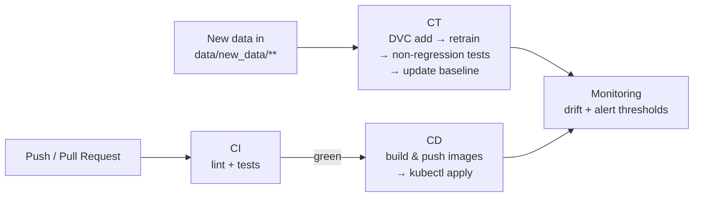

<div align="center">

# 🏭 Industrial Defect Detection

**Defect detection on the MVTec AD dataset, combining a Deep Learning module (PyTorch) with a complete MLOps stack.**


[Overview](#-overview) · [Structure](#-project-structure) · [Installation](#-installation) · [Usage](#-usage) · [Deep Learning](#-deep-learning-phase) · [MLOps](#-mlops-phase)

</div>

---

> [!NOTE]
> **Status: project skeleton.** Signatures, configuration, API, tests and manifests are in place. The business logic (dataset, training, metrics, export, drift) is still to be implemented.

## 📋 Overview

The project covers two complementary tracks:

| Track | Scope |
|-------|-------|
| 🧠 **Deep Learning** | Classification / anomaly detection on MVTec AD images (categories such as `bottle`, `metal_nut`, `screw`, …). **Baseline:** ResNet50, 2 classes (`good` / `defect`), 224×224 images. |
| ⚙️ **MLOps** | Data versioning with **DVC**, experiment tracking with **MLflow**, **FastAPI** inference API, **Docker** containerization, **Kubernetes** deployment, **GitHub Actions** CI/CD, continuous training (CT) triggered by new data, and drift monitoring. |

## 🗂️ Project Structure

```text
industrial-defect-detection/
├── .github/workflows/        # CI, CT (retrain), CD (deploy)
├── configs/                  # params.yaml, alerting.yaml
├── data/                     # raw/, processed/, new_data/ (DVC, not in Git)
├── docker/                   # Dockerfiles + docker-compose
├── frontend/                 # React UI (Vite)
├── k8s/                      # deployment, service, hpa
├── model_registry/           # baseline_metrics.json + artifacts (not in Git)
├── notebooks/                # EDA, experiments, evaluation analysis
├── pipelines/                # train_pipeline.py, prefect_flow.py
├── reports/                  # figures and reports
├── src/                      # config, data, models, api, monitoring, utils
├── tests/                    # unit and non-regression tests
├── dvc.yaml / dvc.lock       # reproducible data pipeline
├── Makefile
└── requirements.txt
```

## 📦 Installation

### Prerequisites

| Tool | Needed for |
|------|-----------|
| Python 3.11 | Backend and training |
| Git | Version control |
| DVC | Data versioning *(installed via `requirements.txt`)* |
| Node.js 22+ | Frontend |
| Docker, Minikube, `kubectl` | Containerization and deployment |

### 1. Backend

```bash
python3.11 -m venv .venv
# Windows: py -3.11 -m venv .venv
source .venv/bin/activate            # Windows: .venv\Scripts\activate

pip install --upgrade pip
pip install -r requirements.txt

cp .env.example .env 2>/dev/null || true
```

### 2. Frontend

```bash
cd frontend
npm install
cd ..
```

### 3. Data

> [!IMPORTANT]
> MVTec AD is **not** versioned in Git. Download it from the [official MVTec page](https://www.mvtec.com/company/research/datasets/mvtec-ad), place the categories in `data/raw/`, then track them with DVC:

```bash
dvc add data/raw
git add data/raw.dvc data/.gitignore .gitignore
git commit -m "data: track MVTec AD with DVC"
```

## 🚀 Usage

### Make commands

| Command | Description |
|---------|-------------|
| `make help` | List all commands |
| `make install` | Create the venv and install dependencies |
| `make train` | Run the training pipeline |
| `make test` | Run `pytest` |
| `make api` | Start the API → http://localhost:8000/docs |
| `make frontend` | Start the UI → http://localhost:5173 |
| `make docker-build` | Build the Docker images |
| `make docker-up` | Start the stack (API `:8000`, frontend `:5173`) |
| `make dvc-init` | Initialize DVC |
| `make dvc-pull` | Pull versioned data |
| `make clean` | Remove generated files |

### API endpoints

| Method | Route | Description |
|:------:|-------|-------------|
| `GET` | `/health` | Service status and loaded model |
| `POST` | `/predict` | Image upload → class + confidence |
| `GET` | `/docs` | OpenAPI documentation |

**Example:**

```bash
curl -F "file=@data/raw/bottle/test/broken_large/000.png" \
     http://localhost:8000/predict
```

## 🧠 Deep Learning Phase

| # | Step | Location |
|:-:|------|----------|
| 1 | **EDA**: class distribution, image sizes, imbalance, defect examples | `notebooks/01_eda.ipynb` |
| 2 | **Training**: train/val split, early stopping, MLflow tracking (parameters, metrics, artifacts) | `src/models/train.py` |
| 3 | **Evaluation**: accuracy, F1, mAP, confusion matrix; comparison with `model_registry/baseline_metrics.json` | `src/models/evaluate.py` |
| 4 | **Export**: ONNX / TorchScript for inference | `src/utils/export.py` |

## ⚙️ MLOps Phase

### Automation workflows



| Workflow | File | Trigger and actions |
|----------|------|---------------------|
| **CI** | `ci.yml` | Lint and tests on every push and pull request |
| **CT** | `ct-retrain.yml` | New batch in `data/new_data/**` → DVC add, retraining, non-regression tests, baseline update on success |
| **CD** | `cd-deploy.yml` | After a green CI → build/push Docker images, `kubectl apply` on Minikube |
| **Monitoring** | `src/monitoring/drift.py` | Computes feature drift and compares metrics against the thresholds in `configs/alerting.yaml` |

### 🚨 Alert thresholds

| Metric | Threshold | Condition for promotion |
|--------|:---------:|-------------------------|
| `accuracy` | **0.85** | must be ≥ threshold |
| `f1` | **0.80** | must be ≥ threshold |
| `mAP` | **0.70** | must be ≥ threshold |
| `drift` | **0.10** | must be ≤ threshold |

> [!WARNING]
> A metric below its threshold (or drift above its threshold) **blocks model promotion** and **triggers an alert**.

### ☸️ Kubernetes (Minikube)

```bash
minikube start
eval $(minikube docker-env)          # PowerShell: & minikube -p minikube docker-env | Invoke-Expression
docker build -f docker/Dockerfile.api -t industrial-defect-detection/api:latest .
kubectl apply -f k8s/deployment.yaml -f k8s/service.yaml -f k8s/hpa.yaml
minikube service industrial-defect-api
```

---

<div align="center">

Built with **PyTorch**, **FastAPI**, **DVC**, **MLflow**, **Docker** and **Kubernetes** 🚀

</div>
