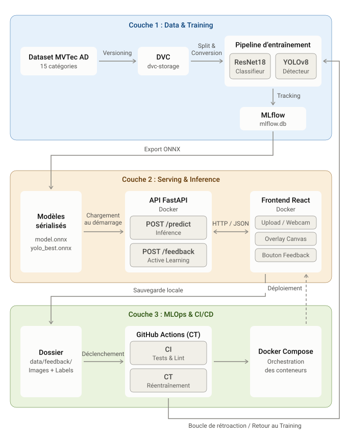

<div align="center">

# 🏭 Industrial Defect Detection

**Détection de défauts sur le dataset MVTec AD, combinant un module Deep Learning (PyTorch/YOLO) et une stack MLOps complète.**


[Architecture](#-architecture) · [Fonctionnalités](#-features) · [Installation](#-installation) · [Usage](#-usage)

</div>

---

> [!NOTE]
> **Statut : Projet terminé.** Le système est fonctionnel de bout en bout, avec une architecture à deux étages (classification + détection), une API conteneurisée, une interface web moderne et une chaîne MLOps complète.

## 📋 Overview

Le projet couvre deux volets complémentaires :

| Volet | Périmètre |
|-------|-----------|
| 🧠 **Deep Learning** | Classification (ResNet18) et détection (YOLOv8) sur les images industrielles (MVTec AD). Gestion du Fine-Tuning progressif et des bounding boxes. |
| ⚙️ **MLOps** | Data versioning (DVC), tracking (MLflow), API FastAPI, conteneurisation (Docker), CI/CD (GitHub Actions), et boucle de Feedback (Active Learning). |

## 🏗 Architecture



1. **Data & Training** : Le dataset est versionné par DVC. Les pipelines d'entraînement génèrent des modèles sérialisés en ONNX. MLflow trace chaque expérience.
2. **Serving** : L'API FastAPI charge les modèles ONNX et expose `/predict` (classifieur + YOLO) et `/feedback`. Le Frontend React permet l'upload, la webcam et l'affichage des bounding boxes.
3. **MLOps** : Les erreurs signalées par les utilisateurs sont stockées dans `data/feedback/` pour déclencher le Continuous Training (CT) via GitHub Actions. Docker orchestre le tout.

## 🚀 Features

- **Double modèle** : ResNet18 (bonne/mauvaise pièce) + YOLOv8 (localisation du défaut).
- **Interface React** : Design moderne (Tailwind), i18n (FR/EN), caméra temps réel, overlay des bounding boxes.
- **Boucle MLOps** : Bouton "Signaler une erreur" qui sauvegarde l'image et le label corrigé dans `data/feedback/`.
- **Versioning** : Git (code), DVC (données), MLflow (expériences).
- **17 Tests** : Validation de l'API, des données et des métriques de non-régression.
- **CI GitHub Actions** : Workflow qui installe `libgl1` et skippe les tests YOLO si le modèle n'est pas présent.

## 📦 Installation

### Prérequis
- Python 3.11
- Node.js 22+
- Docker Desktop

### 1. Backend & API
```bash
py -3.11 -m venv .venv
.\.venv\Scripts\Activate.ps1  # Windows
pip install -r requirements.txt
```

### 2. Data
```bash
# Télécharger MVTec AD et le placer dans data/raw/
dvc pull  # Récupérer les données versionnées
```

### 3. Frontend
```bash
cd frontend
npm install
cd ..
```

## 🚀 Usage

### Docker (Recommandé)
```bash
docker compose -f docker/docker-compose.yml up -d --build
```
- **Frontend** : http://localhost:5173
- **API Swagger** : http://localhost:8000/docs

### Entraînement & Évaluation
```bash
python pipelines/train_pipeline.py --params configs/params.yaml
python scripts/train_yolo.py
python -m src.models.evaluate
```

### Tests
```bash
pytest tests -v  # 17 tests
```

## 🧠 Deep Learning Phase

| Étape | Fichier | Description |
|:-:|------|----------|
| 1 | `src/models/train.py` | Fine-Tuning progressif (ResNet18) avec MLflow et Early Stopping. |
| 2 | `scripts/train_yolo.py` | Entraînement YOLOv8 sur les bounding boxes (15 catégories). |
| 3 | `src/models/evaluate.py` | Calcul du F1-score, mAP et comparaison avec `baseline_metrics.json`. |
| 4 | `src/utils/export.py` | Export ONNX avec vérification de fidélité (Max diff < 1e-4). |

## ⚙️ MLOps Phase

### Automatisation (CI/CT)
| Workflow | Déclencheur | Action |
|----------|------------|--------|
| **CI** | Push / PR | Installe `libgl1`, exécute `pytest` (skip YOLO si absent). |
| **CT** | Nouveaux fichiers dans `data/feedback/` | Réentraînement automatique + tests de non-régression. |

### ☸️ Kubernetes (Optionnel)
```bash
minikube start
kubectl apply -f k8s/deployment.yaml -f k8s/service.yaml
minikube service industrial-defect-api
```

---

<div align="center">

Built with **PyTorch**, **YOLOv8**, **FastAPI**, **DVC**, **MLflow** and **Docker** 🚀

</div>
