<div align="center">

# 🏭 Industrial Defect Detection

**End-to-end defect detection on the MVTec AD dataset, combining a Deep Learning module (PyTorch / YOLO) with a complete MLOps stack.**

<br>


<br>

[📋 Overview](#-overview) •
[🏗 Architecture](#-architecture) •
[✨ Features](#-features) •
[📦 Getting Started](#-getting-started) •
[🚀 Usage](#-usage) •
[🧠 Deep Learning](#-deep-learning-pipeline) •
[⚙️ MLOps](#️-mlops-pipeline)

</div>

---

> [!NOTE]
> **Status: Completed.** The system is fully functional end to end, featuring a two-stage architecture (classification + detection), a containerized API, a modern web interface, and a complete MLOps pipeline. CI is green (17 tests passed). The Continuous Training workflow is triggered automatically by a push on `data/feedback/`.

## 📋 Overview

The project covers two complementary areas:

| Area | Scope |
|:-----|:------|
| 🧠 **Deep Learning** | Classification (ResNet18) and detection (YOLOv8) on industrial images from MVTec AD, with progressive fine-tuning and bounding-box localization. |
| ⚙️ **MLOps** | Data versioning (DVC), experiment tracking (MLflow), inference API (FastAPI), containerization (Docker), CI/CD (GitHub Actions), and a feedback loop for active learning. |

## 🏗 Architecture



| Stage | Description |
|:------|:------------|
| 📊 **1. Data & Training** | The dataset is versioned with DVC. Training pipelines produce models serialized to ONNX, and MLflow tracks every experiment. |
| 🌐 **2. Serving** | The FastAPI service loads the ONNX models and exposes `/predict` (classifier + YOLO) and `/feedback`. The React frontend supports image upload, webcam capture, and bounding-box visualization. |
| 🔄 **3. MLOps** | User-reported errors are stored in `data/feedback/` and trigger Continuous Training (CT) through GitHub Actions. Docker orchestrates the whole stack. |

## ✨ Features

- 🤖 **Dual-model inference**: ResNet18 (good / defective part) followed by YOLOv8 (defect localization).
- 🎨 **Modern React interface**: Tailwind-based design, i18n (FR/EN), real-time camera input, and bounding-box overlay.
- 🔁 **Feedback loop**: a "Report an error" button saves the image and its corrected label to `data/feedback/`.
- 🗂 **Full versioning**: Git (code), DVC (data), MLflow (experiments).
- ✅ **17 automated tests**: API validation, data checks, and non-regression metrics.
- 🛠 **GitHub Actions CI**: installs `libgl1` and skips YOLO tests when the model is not available.

## 📦 Getting Started

### Prerequisites

| Requirement | Version |
|:------------|:--------|
| 🐍 Python | 3.11 |
| 🟢 Node.js | 22+ |
| 🐳 Docker Desktop | Latest |
| ☸️ Minikube | Latest |

### 1. Backend & API

```bash
py -3.11 -m venv .venv
.\.venv\Scripts\Activate.ps1  # Windows
pip install -r requirements.txt
```

### 2. Data

```bash
# Download MVTec AD and place it in data/raw/
dvc pull  # Fetch the versioned data
```

### 3. Frontend

```bash
cd frontend
npm install
cd ..
```

## 🚀 Usage

### 🐳 Docker (recommended)

```bash
docker compose -f docker/docker-compose.yml up -d --build
```

| Service | URL |
|:--------|:----|
| 🖥 Frontend | http://localhost:5173 |
| 📖 API (Swagger) | http://localhost:8000/docs |

### 🏋️ Training & Evaluation

```bash
python pipelines/train_pipeline.py --params configs/params.yaml
python scripts/train_yolo.py
python -m src.models.evaluate
```

### 🧪 Tests

```bash
pytest tests -v  # 17 tests
```

## 🧠 Deep Learning Pipeline

| Step | File | Description |
|:----:|:-----|:------------|
| 1 | `src/models/train.py` | Progressive fine-tuning of ResNet18 with MLflow tracking and early stopping. |
| 2 | `scripts/train_yolo.py` | YOLOv8 training on bounding boxes (15 categories). |
| 3 | `src/models/evaluate.py` | Computes F1-score and mAP, and compares them against `baseline_metrics.json`. |
| 4 | `src/utils/export.py` | ONNX export with fidelity check (max diff < 1e-4). |

## ⚙️ MLOps Pipeline

### 🔄 Automation (CI / CD / CT / Monitoring)

| Workflow | Trigger | Action |
|:---------|:--------|:-------|
| **CI** | Push / Pull Request | Installs `libgl1` and runs `pytest` (17 tests, YOLO tests skipped if model absent). |
| **CT** | **Push on `data/feedback/**`** + manual | Prepares mini dataset, retrains, runs non-regression tests, commits updated metrics. |
| **Monitoring** | Manual (`workflow_dispatch`) | Runs Evidently drift report and uploads it as an artifact. |

### ☸️ Kubernetes (required)

```bash
minikube start
kubectl apply -f k8s/deployment.yaml -f k8s/service.yaml
minikube service industrial-defect-api
```

Two replicas of the API are deployed, guaranteeing high availability and load balancing.

### 🚨 Alerting

Thresholds are defined in `configs/alerting.yaml`:

| Metric | Threshold | Action |
|:-------|:---------:|:-------|
| Accuracy | 85% | Alert if below |
| F1-score | 80% | Alert if below |
| mAP | 70% | Alert if below |
| Data drift | 10% | Alert if above |

The CI gate blocks the promotion of a model whose metrics fall below these thresholds.


<div align="center">

Built with **PyTorch**, **YOLOv8**, **FastAPI**, **DVC**, **MLflow**, **Docker** and **Kubernetes** 🚀

</div>
```
